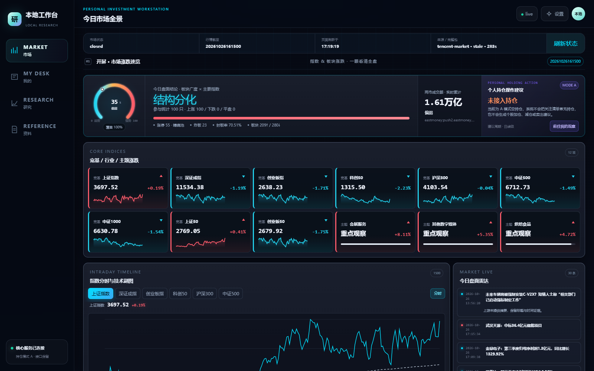
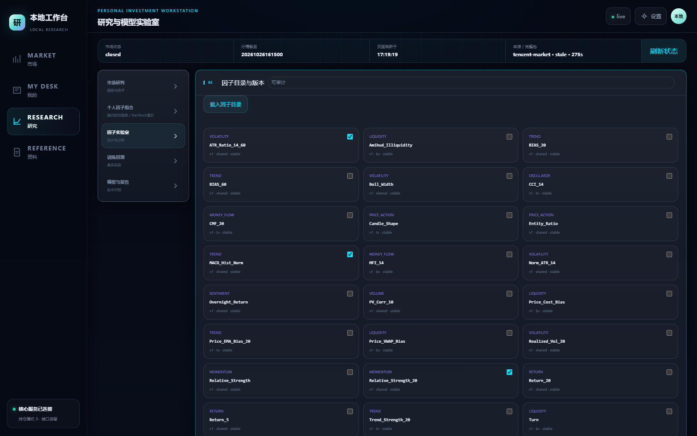
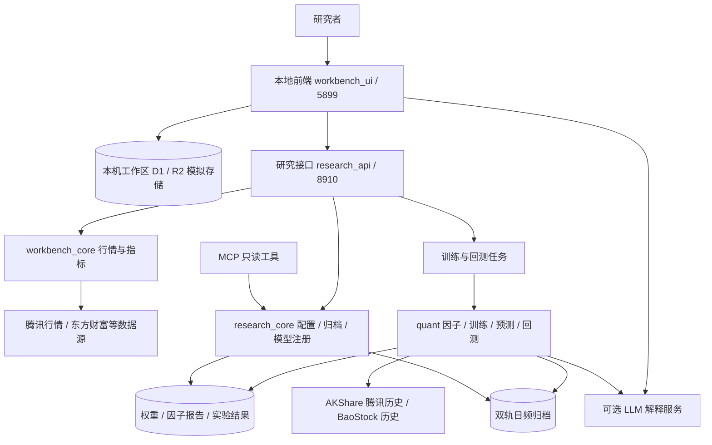
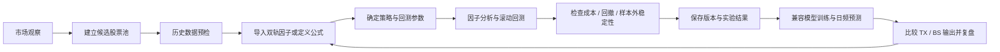
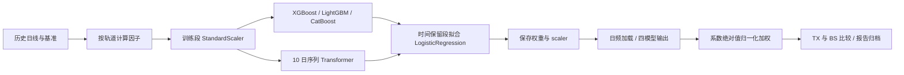

# 股票因子研究工作台 · Stock Factor Workbench

面向 A 股的本地研究工作台，把市场观察、自选股管理、因子设计、策略研究、历史回测和模型报告放在同一个研究流程中。内置原有 TX / BS 双轨预测系统作为可研究、可修改的示例：TX 侧重价格趋势与形态，BS 侧重量价、成交成本与流动性；用户可以选择内置因子、调整研究组合，或通过安全公式定义新因子。

工作台围绕因子挖掘、机器学习建模与 TX/BS 双轨预测，统一组织数据、实验和结果。

## 功能与界面

| 模块 | 可以做什么 | 当前执行范围 |
|---|---|---|
| 市场观察 | 查看指数、板块、资金与新闻，检查数据时间和来源 | 本地 API 拉取与缓存行情 |
| 我的观察 | 管理自选、查看标的和研究线索 | 自选清单与持仓状态分别处理 |
| 因子研究 | 导入双轨预设、选择因子、保存公式与版本 | 公式因子用于研究回测；原始训练器接受兼容内置因子 |
| 策略实验 | 设置股票池、因子权重、周期、成本和窗口 | 通过研究函数或启用后的任务 API 执行 |
| 历史回测 | 查看 IC、Rank IC、分层收益、回撤、滚动样本外结果 | 当前界面读取历史案例，新回测按钮暂未开放 |
| 模型与报告 | 读取双轨归档、管理模型版本、生成可选 AI 解读 | 预测需要本地权重；AI 解读需要供应商配置 |



*市场页面：指数、板块、分时走势与数据状态。*



*研究页面：内置因子目录与组合选择。*

## 整体架构



前端由 React、Vinext/Vite 和本地 Cloudflare 模拟环境提供；Python FastAPI 提供研究接口。市场缓存、研究结果和模型制品各自保存，训练/回测以任务形式运行。前端接口名中的 `cloud` 沿用原命名，本地部署无需云账号。

| 目录或入口 | 功能 |
|---|---|
| `workbench_ui/` | 工作台界面与本机工作区 |
| `workbench_core/` | 行情、指标、时钟与缓存 |
| `research_core/` | 配置、模型注册、归档与只读工具 |
| `quant/` | 原始双轨与因子研究算法 |
| `research_api.py` | HTTP API 与任务入口 |
| `research_mcp_server.py` | MCP 只读查询入口 |
| `scripts/` | 安装、启动、停止与监控 |
| `tests/` | 后端回归测试 |
| `docs/` | 因子索引与截图 |

## 从选股到复盘的使用流程



### 1. 建立候选股票池

从“市场”查看板块与指数，再在“我的”维护关注标的，结合市场信息和模型分数建立研究股票池、比较候选结果。

进入研究模块后输入六位 A 股代码并做历史数据预检。`POST /api/universe/validate` 接受 1–50 个代码；因子回测至少需要 3 只有足够历史数据的股票，每只至少 120 行。正式横截面研究宜使用更宽的股票池，以免少数样本决定排名。先固定股票池与数据日期，再比较策略，记录退市、停牌、复权和样本选择方式。

### 2. 选择因子或自定义公式

在“研究 → 个人因子组合”导入 TX/BS 预设，在“因子实验室”载入目录并选择因子。导入仅填充选择，不会自动训练或覆盖已有模型。

可从一个简单假设开始：相对强势、趋势延续且波动不过高的股票，未来表现是否更好？例如选择 `Relative_Strength_20`、`Return_20`、`ATR_Ratio_14_60`，再定义：

```text
Return_20 / (ATR_Ratio_14_60 + 0.00000001)
```

该公式把 20 日收益与短长波动比结合，用于检验“趋势相对于波动”的解释力。公式支持已计算列、数值常量、括号、加减乘除和乘方；不支持任意 Python、函数调用或自行编写 `rolling()`。新增窗口计算需扩展 Python 因子实现。

因子名称、公式、方向、窗口与版本等信息可保存；具体计算以 `quant/factor_backtest.py` 的执行逻辑为准。元数据字段本身不会自动生成中性化或缺失值处理算法。自定义公式可进入研究回测，不能直接送入原始四模型训练器；将其接入训练还需同步训练和推理的特征定义、顺序与制品。

### 3. 把因子假设写成策略配置

研究配置至少包含股票池、日期、因子集合、标签周期、训练/测试窗口、手续费和滑点。普通 T+1 滚动研究在训练段估计因子方向及权重，在测试段计算横截面标准化分数：

$$S_{i,t}=\sum_j w_j d_j\frac{x_{i,j,t}-\mu_{j,t}}{\sigma_{j,t}}$$

其中 $d_j$ 来自训练期 Rank IC 的符号；权重来自用户输入或训练期绝对 Rank IC，归一化后使用。测试股票按分数排序。该分数是因子组合排序分数，与双轨机器学习输出的 `raw_prob` 不同。

策略比较可以依次做“单因子 → 等权组合 → 训练期确定方向和权重”，固定测试日期，比较加入成本后的增量。更改因子集合应保存新版本，避免用同一段历史反复调参后再称其为独立验证。

### 4. 运行历史回测

页面“训练回测”目前读取已存在的历史案例，执行按钮保持关闭。新实验可在安装完整模型依赖后调用研究函数；以下示例展示回测配置与调用方式。在仓库根目录运行：

```python
from quant.factor_backtest import run_factor_backtest

result = run_factor_backtest(
    stocks=["600522", "002335", "000657", "601899"],
    factors=["Relative_Strength_20", "Return_20", "ATR_Ratio_14_60"],
    config={
        "dateFrom": "2021-01-01", "dateTo": "2025-12-31",
        "labelHorizon": 1, "walkForward": True,
        "minTrainDays": 252, "testWindowDays": 60,
        "feeBps": 8, "slippageBps": 5,
    },
    output_dir="research-runs/example-01",
)
print(result["walkForwardResults"])
```

示例代码需要网络，`output_dir` 必须是尚不存在的目录。输出包含 `factorMetrics`、`factorRelationships`、`walkForwardResults`、配置与数据指纹，并写入 `factor-metrics.json`。自定义因子通过 `config.customFactorFormulas` 传入名称到公式的映射，并将名称加入 `factors`。

另一条执行路径为任务 API：显式设置 `ENABLE_BACKTEST_API=1`，直接用 Uvicorn 启动后向 `POST /api/jobs` 提交 `mode="backtest"` 的任务，再读取 `/api/jobs/{id}`。常规 `start_backend.ps1` 会强制关闭新回测，因此不能只改 `.env` 后继续使用该启动器。API 至少需要 3 个兼容因子和 3–50 只股票。

### 5. 阅读回测结果

| 指标 | 计算与用途 |
|---|---|
| IC | 每日横截面因子值与未来 H 日收益的 Pearson 相关 |
| Rank IC | 对两者排名后求相关，检验排序能力 |
| ICIR | 代码按平均 Rank IC / 标准差 × √(252/H) 计算 |
| 因子相关与边际贡献 | 比较因子重叠，检查移除某因子后的组合 Rank IC 变化 |
| 成本后收益 | 组合收益扣除换手对应的手续费与滑点 |
| 最大回撤 | 净值相对于历史峰值的最大下降幅度 |
| 滚动窗口结果 | 逐窗检查训练终点、测试起点、方向与权重 |

普通因子分层回测使用高分组 50% 多头、低分组 50% 空头：`gross = 0.5 × 多头均值收益 − 0.5 × 空头均值收益`；`net = gross − turnover × (feeBps + slippageBps) / 10000`。它是因子研究组合，尚未实现完整的 A 股借券、成交撮合、涨跌停排队与现金约束。标签使用未来收盘价收益；收盘信号能否以该价格成交需要进一步验证。当前初始建仓换手记为 0，`rebalanceEvery > 1` 会跳过部分日期，不能据此直接宣称完整持有期实盘收益。

`local_tx_bs` 双周期示例采用各轨道因子集、StandardScaler 与逻辑回归，在扩展训练窗口上重新拟合：T+1 统计候选关注命中，T+5 使用非重叠持有期统计假设收益并扣双边成本。它复用了双轨因子思想，**没有重跑下面原始系统的四个基模型**；其结果不能当作原始四模型系统的回测成绩。

### 6. 训练、预测与复盘

因子研究之后，再选择兼容的原始训练路径。主板训练 API 支持每轨至少 3 个兼容内置因子；但现有日频预测仍按固定特征集合加载模型，变更特征子集的候选制品不能直接替换默认模型，需同步推理配置并验证。

日频预测读取权重，生成 TX 和 BS 分数与分歧信息；报告记录日期、股票、模型输出和可选 LLM 解读。复盘时比较数据是否完整、信号是否一致、未来标签是否兑现，把问题反馈到因子与训练环节。LLM 负责解释结构化证据，分数由量化代码计算。

## 内置示例：原有双轨系统如何工作

### 两条数据轨道，四套特征配置

TX 指腾讯历史数据路径，BS 指 BaoStock 路径。每条路径按科技成长与主板使用独立因子集合和制品目录。科技分组由源码股票列表决定，并非自动识别行业；更换股票池时需同步训练与预测清单。

| 路径 | 重点 | 因子数 | 训练模块 | 默认权重目录 |
|---|---|---:|---|---|
| 科技 TX | 趋势、形态、资金流 | 13 | `quant.train_tech_tx` | `models_tx` |
| 科技 BS | 换手、成交成本、量价 | 13 | `quant.train_tech_bs` | `models` |
| 主板 TX | 纯价格趋势与反转 | 10 | `quant.train_mainboard_tx` | `models_tx_v7` |
| 主板 BS | 量价、VWAP 与流动性 | 10 | `quant.train_mainboard_bs` | `models_bs_v6` |

完整分组见 [因子清单](docs/FACTOR_CATALOG.md)。主板 TX 不依赖成交量；科技 TX 仍包含量价因子。两条轨道的同向输出表示不同特征视角的一致性，不能理解为统计独立的两次预测。

### 因子计算

记 $C,O,H,L,V,A$ 为收盘、开盘、最高、最低、成交量和成交额，$r$ 为日收益、$r_m$ 为基准日收益；`MA_n`、`EMA_n`、`std_n` 分别为 n 日均值、指数均值与标准差。下表省略代码中防止除零的小量；成交额、成交量与涨跌幅必须先统一单位。

| 因子 | 当前源码的计算 | 研究含义 |
|---|---|---|
| Relative_Strength | `r − r_m` | 单日相对表现 |
| Relative_Strength_20 | `C/C[-20] − 1 − sum_20(r_m)` | 20 日相对表现；基准采用求和近似 |
| Return_5 / Return_20 | `C/C[-n] − 1` | 短中期动量 |
| BIAS_20 / BIAS_60 | `C/MA_n(C) − 1` | 相对均线的偏离 |
| Price_EMA_Bias_20 | `C/EMA_20(C) − 1` | 相对平滑趋势的偏离 |
| MACD_Hist_Norm | `(DIF − EMA_9(DIF))/C`，`DIF=EMA_12(C)−EMA_26(C)` | 归一化趋势变化 |
| Z_Score_20 | `(C−MA_20(C))/std_20(C)` | 价格偏离程度 |
| Norm_ATR_14 | `MA_14(TR)/C` | 相对波幅 |
| ATR_Ratio_14_60 | `MA_14(TR)/MA_60(TR)` | 短长波动状态 |
| Vol_Ratio / Vol_Surge_60 | `V/MA_20(V)` / `V/MA_60(V)` | 成交活跃程度 |
| Turn | BaoStock 换手率除以 100 | 换手水平 |
| Entity_Ratio | `abs(C−O)/(H−L)` | K 线实体占比 |
| Candle_Shape | `(C−L)/(H−L)` | 收盘在日内区间中的位置 |
| Boll_Width | `2×std_20(C)/MA_20(C)` | 当前实现的相对波动宽度 |
| Realized_Vol_20 | `std_20(r)×sqrt(252)` | 年化历史波动 |
| PV_Corr_10 | `corr_10(C,V)` | 量价相关 |
| Overnight_Return | `O/C[-1] − 1` | 隔夜跳空 |
| Price_Cost_Bias | `C/(A/V) − 1` | 相对当日平均成交成本 |
| Price_VWAP_Bias | `C/(sum_20(A)/sum_20(V)) − 1` | 相对 20 日成交成本 |
| CMF_20 | `sum_20(CLV×V)/sum_20(V)`，`CLV=(2C−L−H)/(H−L)` | 量加权的收盘位置 |
| Trend_Strength_20 | `(C−C[-20])/(max_20(H)−min_20(L))` | 区间内趋势推进 |
| Williams_R_14 | `−100×(max_14(H)−C)/(max_14(H)−min_14(L))` | 价格区间位置 |
| CCI_14 | `(TP−MA_14(TP))/(0.015×std_14(TP))`，`TP=(H+L+C)/3` | 典型价格偏离 |
| MFI_14 | `100−100/(1+正向资金流14日和/负向资金流14日和)` | 典型价格上升/下降时的量价流 |
| Amihud_Illiquidity | `MA_20(abs(r)/(A/1e8))` | 单位成交金额对应的价格变化 |

其中 `TR=max(H,C[-1])−min(L,C[-1])`；MFI 的每日资金流为 `TP×V`，由 TP 相对前日的方向归入正向或负向。当前 CCI 使用标准差而非经典平均绝对偏差；Boll_Width 使用 `2σ/MA`。复现时应遵循代码定义，不能直接替换同名第三方指标。

### 标签、训练与模型融合

原始标签意图是预测下一交易日是否跑赢基准：

$$y_t=\mathbf{1}(r_{t+1}>r_{m,t+1})$$

它判断相对收益方向，不等于“下一日上涨”。例如股票跌 1%、基准跌 2%，仍符合超额为正的标签。



按每只股票分别训练。前 80% 时间样本用于标准化与基模型训练，后 20% 用于融合模型；这是时间保留段 stacking。三类树模型处理单日特征，Transformer 使用长度为 10 的序列，线性嵌入到 64 维、4 个注意力头、2 层编码器，末位置输出经 Sigmoid 得到分数。序列与目标的实际对齐仍需按下面实现边界检查。

**训练与日频融合的实现不同。** 训练保存逻辑回归模型，但 `predict_tx.py` / `predict_bs.py` 实际取其四个系数的绝对值归一化，再对四个基模型分数加权：

$$w_k=\frac{|\beta_k|}{\sum_j|\beta_j|+\epsilon},\qquad raw\_prob=\sum_{k=1}^{4}w_kp_k$$

推理没有直接调用逻辑回归的 Sigmoid，也没有使用其截距和系数符号。界面沿用“胜率”字段，实际应按未经独立校准的模型分数解释。双轨日报以 0.53 为旧示例阈值：两轨均达到阈值、仅一轨达到、两轨均未达到分别生成一致或分歧提示。阈值属于研究配置，不是已经验证的交易规则。

### 复现时必须核对的实现边界

复现模型时，重点检查以下数据处理与训练、推理一致性问题。

- 主板训练将全样本拟合的 scaler 保存，但树模型仍使用此前训练段 scaler 产生的矩阵重拟合；训练与推理变换存在不一致，需要统一后重新训练。
- 主板 `PctChg` 采用“最大绝对值大于 10 才除以 100”的启发式；腾讯字段缺失时还会填 0。须验证涨跌幅列与基准同为小数收益，否则标签失真。
- `shift(-1)` 后直接比较再转整数会把无未来标签的末行变为 0；有效训练集应显式排除这类行。
- Transformer 训练片段 `X[i-10:i]` 对应 `y[i]`，推理却使用截至最新日的 10 行；需要明确目标交易日并统一序列对齐。
- 因子组合回测通过 AKShare 腾讯历史构建统一面板，其成本/换手字段来源与原始 BaoStock 训练不同；需要检查字段覆盖、单位和代理量，不能假定同名因子逐值一致。

这些问题影响模型复现与结果解释。代码测试验证接口和研究函数的行为，不能替代上述模型数据一致性检查或独立样本外验证。

## 部署与使用

### 1. 环境与安装

目标环境为 Windows。需要 Python 3.10+、Node.js 22.13+、pnpm；使用 Git 克隆时安装 Git。先检查 `python --version`、`node --version`、`pnpm --version`。

```powershell
git clone https://github.com/MottoZ123/dualalpha-lite.git
cd dualalpha-lite
powershell -NoProfile -ExecutionPolicy Bypass -File .\scripts\setup_local.ps1
```

安装脚本创建 `.venv`，安装 API、离线测试、pandas/numpy 与前端依赖；已有 `.env` 不会被覆盖。需要训练和双轨预测时：

```powershell
powershell -NoProfile -ExecutionPolicy Bypass -File .\scripts\setup_local.ps1 -FullModelStack
```

模型栈包括 AKShare、BaoStock、XGBoost、LightGBM、CatBoost、PyTorch、scikit-learn、SHAP 等。Python 依赖沿用原项目范围，未锁定全部传递版本；旧权重跨版本加载需验证。前端使用 pnpm-lock.yaml。

安装和行情访问需要网络；源码包不附带权重、个人报告或依赖目录。macOS/Linux 未在本轮验证。

### 2. 配置

首次安装会从 `.env.example` 创建 `.env`。按实际账户填写密钥，模型名以账户可调用版本为准。

| 配置 | 用途/默认行为 |
|---|---|
| DEEPSEEK_API_KEY / MODEL / BASE_URL | DeepSeek 文字报告 |
| VOLCENGINE_API_KEY / MODEL / BASE_URL | 火山方舟文字报告 |
| RESEARCH_API_KEY | 后端 Bearer Key；纯本机可留空 |
| RESEARCH_ALLOW_ORIGINS | 默认允许本机 5899 |
| ENABLE_MODEL_EXECUTION_API | 默认 0，关闭主动预测接口 |
| ENABLE_TRAINING_API | 默认 0，关闭训练接口 |
| ENABLE_BACKTEST_API | 默认 0，启动器继续强制关闭新回测 |
| RESEARCH_DATA_DIR | 任务/模型注册等研究数据目录 |
| RESEARCH_REPORTS_DIR | 日报读取目录 |
| TRAINING_RUNS_DIR | 独立训练任务目录 |

公共观察标的、刷新设置和 Vibe 开关位于 `workbench-config.json`。未启用 Vibe 时无需安装它。

界面“模型连接”支持多家兼容服务，API Key 仅用于当前页面会话。界面配置与根目录 `.env` 是两条独立配置路径，不会互相自动复制密钥。

### 3. 启动与验收

在仓库根目录的两个终端分别执行：

```powershell
powershell -NoProfile -ExecutionPolicy Bypass -File .\scripts\start_backend.ps1
```

```powershell
powershell -NoProfile -ExecutionPolicy Bypass -File .\scripts\start_workbench.ps1
```

浏览器访问 http://127.0.0.1:5899；后端 API 文档为 http://127.0.0.1:8910/docs。

首次检查：

1. `/api/health` 返回存活状态；等待数据预热后检查 `/api/ready`。
2. 首页能显示市场区块，并标明数据来源和时间。
3. 添加自选后刷新，确认工作区可以保存和回读。
4. 查看双轨归档日期；没有模型/报告时显示为空属于预期。
5. 需要 AI 时再填写模型连接并执行连接测试。

停止界面使用其终端的 Ctrl+C。停止后端可运行 `scripts/stop_backend.ps1`，它只结束当前目录锁记录中匹配的后端进程。监控脚本 `watch_backend.ps1` 应先停止，防止再次拉起服务。

### 4. 自定义路径与端口

启动器默认研究数据为 `.motto-runtime/live-data`，日报为 `AB_Test_Reports`。若要更改，在启动前设置进程变量：

```powershell
$env:RESEARCH_DATA_DIR='D:\research-data\workbench'
$env:RESEARCH_REPORTS_DIR='D:\research-data\reports'
powershell -NoProfile -ExecutionPolicy Bypass -File .\scripts\start_backend.ps1
```

启动器设置的进程值优先于 Python 后续加载的 `.env`。前端默认通过启动脚本连接 8910；手动执行 `pnpm run dev` 时，应先设置 `NEXT_PUBLIC_RESEARCH_API_URL=http://127.0.0.1:8910`。

如果更改前端端口，需要同时修改启动命令/配置和后端允许的 Origin；更改后端端口还要同步界面连接地址、监控脚本。默认部署建议沿用 5899/8910，端口占用时先确认占用进程。

### 5. 训练与每日预测

先安装 `-FullModelStack`。下列脚本在仓库根目录执行，会写入对应模型目录；已有模型先备份。

```powershell
.\.venv\Scripts\python.exe -m quant.train_tech_tx
.\.venv\Scripts\python.exe -m quant.train_tech_bs
.\.venv\Scripts\python.exe -m quant.train_mainboard_tx
.\.venv\Scripts\python.exe -m quant.train_mainboard_bs
.\.venv\Scripts\python.exe -m quant.daily_report
```

科技 TX/BS 模型分别写入 `models_tx` / `models`，主板 TX/BS 分别写入 `models_tx_v7` / `models_bs_v6`。检查每只股票的训练日志和模型文件，不只看进程退出码。日报归档到 `AB_Test_Reports/日期/`；没有 LLM 凭证时优先查看原始预测。旧的独立对照入口已合并到当前双轨日报流程。

本包不自动创建定时任务。计划任务应固定仓库工作目录和 `.venv\Scripts\python.exe`，并检查脚本的交互输入、网络和日志。原始模型训练与 `quant/factor_backtest.py` 的因子实验属于不同研究流程，结果不应混用。

### 6. MCP

在支持标准输入输出 MCP 的客户端中，把 command 指向本仓库虚拟环境的 Python，args 指向 `research_mcp_server.py` 的绝对路径：

```json
{
  "command": "D:\\path\\dualalpha-lite\\.venv\\Scripts\\python.exe",
  "args": ["D:\\path\\dualalpha-lite\\research_mcp_server.py"],
  "env": {"RESEARCH_REPORTS_DIR": "D:\\path\\dualalpha-lite\\AB_Test_Reports"}
}
```

它提供归档预测、双轨比较和可选数据查询等只读工具。Vibe 查询需要另行运行该服务。

### 7. 更新、备份与清理

| 内容 | 处理方式 |
|---|---|
| 源码、workbench-config.json | 提交前检查差异，更新时保留自定义配置 |
| .env、models*、AB_Test_Reports | 本机备份，不上传 |
| workbench_ui/.wrangler | 本地工作区数据库，停服务后备份 |
| .motto-runtime、.motto-cache、.dash_state.json | 运行记录、缓存和状态，按用途保留 |
| node_modules、dist、__pycache__ | 可重建，不进入发布包 |

更新前停止服务并备份状态，再 `git pull --ff-only`。依赖变动时重跑安装脚本，之后执行测试和页面检查。本次 `motto_core` 改为 `workbench_core`，配置改为 `workbench-config.json`；自定义 Python 导入需同步。历史配置文件名提供读取回退，磁盘数据库和缓存名保持兼容。

### 8. 常见问题

| 现象 | 检查 |
|---|---|
| health 成功、ready 为 503 | 数据预热进度、上游网络与缓存有效期 |
| 页面没有行情 | 8910 是否启动、界面连接地址、Origin、数据源返回 |
| 双轨没有结果 | 是否已有四套权重、日报生成成功、报告读取路径正确 |
| 模型不存在/无权限 | 供应商账户实际模型名、Endpoint、Key 和网络 |
| 不能保存工作区 | 本地运行环境是否完整、.wrangler 是否可写 |
| 提示已有实例 | 查看锁中的进程，通过 stop_backend 停止自己的实例 |
| 交易日历越界 | 更新年度日历；当前内置覆盖 2026 年 |

默认只监听本机。公网身份认证、HTTPS、远程访问及授权行情订阅不属于此部署方式。

## 验证与协作

已有验证记录包括 43 项后端测试、4 项前端测试、前端构建，以及市场与因子页面连接后端的检查。

```powershell
.\.venv\Scripts\python.exe -m unittest discover -s tests -v
cd workbench_ui
pnpm run build
node --test tests/local-workbench.test.mjs
```

主要作者：[Mary-wym](https://github.com/Mary-wym)；共同作者：[MottoZ123](https://github.com/MottoZ123)。可选 [Vibe-Research](https://github.com/simonlin1212/Vibe-Research) 适配默认关闭。依赖见 requirements 文件与前端 package.json；原项目尚未提供根 LICENSE。
