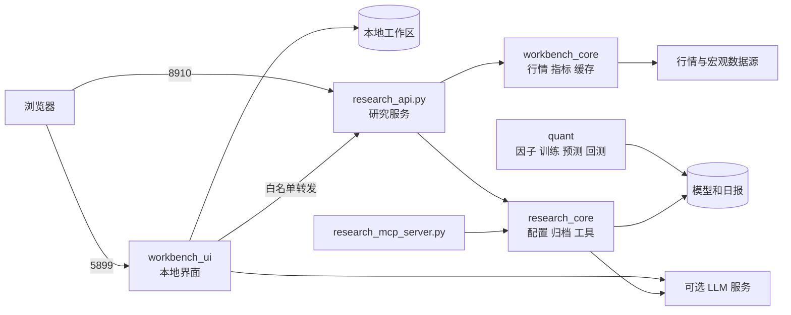

# 本地工作台

基于 TX/BS 双轨集成模型的本地量化研究工具，包含行情观察、自选分析、因子研究和可选 AI 解读。

## 界面效果

以下为本项目实际运行页面截图。来自新建环境，没有导入个人模型、日报或账户；缺失数据按页面状态显示，不代表模型表现。


*市场总览：指数、板块、市场状态与数据来源。*


*研究页面：因子方案、双轨研究入口与证据指标。*

## 整体架构



| 目录/入口 | 功能 |
|---|---|
| `quant/` | 原始因子、四套训练、双轨预测和回测。 |
| `workbench_core/` | 行情适配、指标计算、市场时钟和缓存。 |
| `research_core/` | 配置、预测归一化、模型服务和只读工具。 |
| `workbench_ui/` | 界面、模型连接和本地工作区。 |
| `scripts/` | 安装、启动、停止和监控。 |
| `tests/` | 后端回归测试。 |
| `docs/` | 效果图、因子清单和研究方法。 |
| `research_api.py` | HTTP 研究接口。 |
| `research_mcp_server.py` | MCP 标准输入输出接口。 |
| `workbench-config.json` | 标的和刷新配置。 |

### 数据如何流动

1. 前端从 5899 加载，读取本机工作区，并连接 8910 研究服务。
2. 后端从缓存或行情源取得数据，计算技术指标；`/api/all` 返回整页数据，`/api/realtime` 返回更新项。
3. `quant` 中的训练脚本生成模型，每日预测生成日期归档；研究页面读取归档并标明时间。
4. LLM 接收结构化证据并生成解释，不代替四模型预测。
5. 训练、主动预测和新回测 API 默认关闭；只有显式开启后才执行相应任务。

### 服务和状态

| 接口/状态 | 用途 |
|---|---|
| `/api/health` | 进程存活。 |
| `/api/ready` | 关键行情数据是否就绪。 |
| `/api/research/dual-track/latest` | 日频双轨归档。 |
| `/api/research/factor-presets` | 因子预设。 |
| `/api/jobs` | 受开关控制的研究任务。 |
| `/api/research/models` | 模型版本与状态。 |
| 前端 `/api/cloud/workspace` | 本机工作区读写。 |
| 前端 `/api/cloud/provider/test`、`analysis` | 模型测试与分析。 |
| 前端 `/api/cloud/rich/context` | 受限后端转发。 |

完整请求结构见运行中的 `http://127.0.0.1:8910/docs`。前端的 `cloud` 路径沿用接口命名；存储通过本地 Miniflare 模拟，无需云账号。数据携带来源、时间与降级状态；缓存使用最后可用结果和 ETag，缺失值不伪装为零。`health` 成功不等于行情已经就绪。

## 双轨预测与因子

| 轨道 | 特征 | 训练模块 |
|---|---|---|
| TX 科技成长 | 13 项趋势、形态与资金流特征 | `quant.train_tech_tx` |
| BS 科技成长 | 13 项成本偏离、换手与量价特征 | `quant.train_tech_bs` |
| TX 主板 | 10 项价格结构与反转特征 | `quant.train_mainboard_tx` |
| BS 主板 | 10 项 VWAP、资金流与流动性特征 | `quant.train_mainboard_bs` |

每条路径使用 XGBoost、LightGBM、CatBoost、Transformer，再由逻辑回归融合输出。`raw_prob` 是模型分数，独立验证和概率校准另行评估。因子见 [因子清单](docs/FACTOR_CATALOG.md)，训练与回测口径见 [研究方法](docs/RESEARCH_METHODS.md)。

### 量化文件索引

| 模块 | 功能 |
|---|---|
| `quant/predict_tx.py`、`predict_bs.py` | 双轨日频预测。 |
| `quant/train_tech_*.py`、`train_mainboard_*.py` | 四套模型训练。 |
| `quant/report_tx.py`、`report_bs.py` | 轨道报告提示词。 |
| `quant/daily_report.py` | 每日双轨运行与归档。 |
| `quant/explain_tx.py`、`explain_bs.py` | 因子解释与 SHAP。 |
| `quant/backtest_tech.py`、`backtest_mainboard.py` | 原始滚动回测。 |
| `quant/factor_backtest.py` | 因子计算及双周期研究。 |

## 部署与使用

### 1. 环境与安装

目标环境为 Windows。需要 Python 3.10+、Node.js 22.13+、pnpm；使用 Git 克隆时安装 Git。先检查 `python --version`、`node --version`、`pnpm --version`。

```powershell
git clone https://github.com/MottoZ123/dualalpha-lite.git
cd dualalpha-lite
powershell -NoProfile -ExecutionPolicy Bypass -File .\scripts\setup_local.ps1
```

安装脚本创建 `.venv`，安装 API、离线测试、pandas/numpy 与前端依赖；已有 `.env` 不会被覆盖。需要训练和双轨预测时：

```powershell
powershell -NoProfile -ExecutionPolicy Bypass -File .\scripts\setup_local.ps1 -FullModelStack
```

模型栈包括 AKShare、BaoStock、XGBoost、LightGBM、CatBoost、PyTorch、scikit-learn、SHAP 等。Python 依赖沿用原项目范围，未锁定全部传递版本；旧权重跨版本加载需验证。前端使用 pnpm-lock.yaml。

安装和行情访问需要网络；源码包不附带权重、个人报告或依赖目录。macOS/Linux 未在本轮验证。

### 2. 配置

首次安装会从 `.env.example` 创建 `.env`。按实际账户填写密钥，模型名以账户可调用版本为准。

| 配置 | 用途/默认行为 |
|---|---|
| DEEPSEEK_API_KEY / MODEL / BASE_URL | DeepSeek 文字报告 |
| VOLCENGINE_API_KEY / MODEL / BASE_URL | 火山方舟文字报告 |
| RESEARCH_API_KEY | 后端 Bearer Key；纯本机可留空 |
| RESEARCH_ALLOW_ORIGINS | 默认允许本机 5899 |
| ENABLE_MODEL_EXECUTION_API | 默认 0，关闭主动预测接口 |
| ENABLE_TRAINING_API | 默认 0，关闭训练接口 |
| ENABLE_BACKTEST_API | 默认 0，启动器继续强制关闭新回测 |
| RESEARCH_DATA_DIR | 任务/模型注册等研究数据目录 |
| RESEARCH_REPORTS_DIR | 日报读取目录 |
| TRAINING_RUNS_DIR | 独立训练任务目录 |

公共观察标的、刷新设置和 Vibe 开关位于 `workbench-config.json`。未启用 Vibe 时无需安装它。

界面“模型连接”支持多家兼容服务，API Key 仅用于当前页面会话。界面配置与根目录 `.env` 是两条独立配置路径，不会互相自动复制密钥。

### 3. 启动与验收

在仓库根目录的两个终端分别执行：

```powershell
powershell -NoProfile -ExecutionPolicy Bypass -File .\scripts\start_backend.ps1
```

```powershell
powershell -NoProfile -ExecutionPolicy Bypass -File .\scripts\start_workbench.ps1
```

浏览器访问 http://127.0.0.1:5899；后端 API 文档为 http://127.0.0.1:8910/docs。

首次检查：

1. `/api/health` 返回存活状态；等待数据预热后检查 `/api/ready`。
2. 首页能显示市场区块，并标明数据来源和时间。
3. 添加自选后刷新，确认工作区可以保存和回读。
4. 查看双轨归档日期；没有模型/报告时显示为空属于预期。
5. 需要 AI 时再填写模型连接并执行连接测试。

停止界面使用其终端的 Ctrl+C。停止后端可运行 `scripts/stop_backend.ps1`，它只结束当前目录锁记录中匹配的后端进程。监控脚本 `watch_backend.ps1` 应先停止，防止再次拉起服务。

### 4. 自定义路径与端口

启动器默认研究数据为 `.motto-runtime/live-data`，日报为 `AB_Test_Reports`。若要更改，在启动前设置进程变量：

```powershell
$env:RESEARCH_DATA_DIR='D:\research-data\workbench'
$env:RESEARCH_REPORTS_DIR='D:\research-data\reports'
powershell -NoProfile -ExecutionPolicy Bypass -File .\scripts\start_backend.ps1
```

启动器设置的进程值优先于 Python 后续加载的 `.env`。前端默认通过启动脚本连接 8910；手动执行 `pnpm run dev` 时，应先设置 `NEXT_PUBLIC_RESEARCH_API_URL=http://127.0.0.1:8910`。

如果更改前端端口，需要同时修改启动命令/配置和后端允许的 Origin；更改后端端口还要同步界面连接地址、监控脚本。默认部署建议沿用 5899/8910，端口占用时先确认占用进程。

### 5. 训练与每日预测

先安装 `-FullModelStack`。下列脚本在仓库根目录执行，会写入对应模型目录；已有模型先备份。

```powershell
.\.venv\Scripts\python.exe -m quant.train_tech_tx
.\.venv\Scripts\python.exe -m quant.train_tech_bs
.\.venv\Scripts\python.exe -m quant.train_mainboard_tx
.\.venv\Scripts\python.exe -m quant.train_mainboard_bs
.\.venv\Scripts\python.exe -m quant.daily_report
```

科技 TX/BS 模型分别写入 `models_tx` / `models`，主板 TX/BS 分别写入 `models_tx_v7` / `models_bs_v6`。检查每只股票的训练日志和模型文件，不只看进程退出码。日报归档到 `AB_Test_Reports/日期/`；没有 LLM 凭证时优先查看原始预测。旧的独立对照入口已合并到当前双轨日报流程。

本包不自动创建定时任务。计划任务应固定仓库工作目录和 `.venv\Scripts\python.exe`，并检查脚本的交互输入、网络和日志。原始模型训练与 `quant/factor_backtest.py` 的因子实验属于不同研究流程，结果不应混用。

### 6. MCP

在支持标准输入输出 MCP 的客户端中，把 command 指向本仓库虚拟环境的 Python，args 指向 `research_mcp_server.py` 的绝对路径：

```json
{
  "command": "D:\\path\\dualalpha-lite\\.venv\\Scripts\\python.exe",
  "args": ["D:\\path\\dualalpha-lite\\research_mcp_server.py"],
  "env": {"RESEARCH_REPORTS_DIR": "D:\\path\\dualalpha-lite\\AB_Test_Reports"}
}
```

它提供归档预测、双轨比较和可选数据查询等只读工具。Vibe 查询需要另行运行该服务。

### 7. 更新、备份与清理

| 内容 | 处理方式 |
|---|---|
| 源码、workbench-config.json | 提交前检查差异，更新时保留自定义配置 |
| .env、models*、AB_Test_Reports | 本机备份，不上传 |
| workbench_ui/.wrangler | 本地工作区数据库，停服务后备份 |
| .motto-runtime、.motto-cache、.dash_state.json | 运行记录、缓存和状态，按用途保留 |
| node_modules、dist、__pycache__ | 可重建，不进入发布包 |

更新前停止服务并备份状态，再 `git pull --ff-only`。依赖变动时重跑安装脚本，之后执行测试和页面检查。本次 `motto_core` 改为 `workbench_core`，配置改为 `workbench-config.json`；自定义 Python 导入需同步。历史配置文件名提供读取回退，磁盘数据库和缓存名保持兼容。

### 8. 常见问题

| 现象 | 检查 |
|---|---|
| health 成功、ready 为 503 | 数据预热、上游网络、缓存过期；不要伪造就绪状态 |
| 页面没有行情 | 8910 是否启动、界面连接地址、Origin、数据源返回 |
| 双轨没有结果 | 是否已有四套权重、日报生成成功、报告读取路径正确 |
| 模型不存在/无权限 | 供应商账户实际模型名、Endpoint、Key 和网络 |
| 不能保存工作区 | 本地运行环境是否完整、.wrangler 是否可写 |
| 提示已有实例 | 查看锁中的进程，通过 stop_backend 停止自己的实例 |
| 交易日历越界 | 更新年度日历；当前内置覆盖 2026 年 |

默认只监听本机。公网身份认证、HTTPS、远程访问及授权行情订阅不属于此部署方式。

## 结构调整

有效旧源码收进 `quant`，已同步内部导入和 API 调用。重复日报入口、未引用的旧包装与实验脚本从当前版本移除；历史版本保留在 Git。模型、日报和因子报告目录在运行时创建，不再提交空占位。已有本机产物路径和数据库名保留兼容。

## 验证

```powershell
.\.venv\Scripts\python.exe -m unittest discover -s tests -v
cd workbench_ui
pnpm run build
node --test tests/local-workbench.test.mjs
```

本次在新建环境验证安装、43 项后端测试、4 项前端测试、前端构建和页面截图；不重新训练四套模型，不将界面截图或单元测试当作收益验证。原始训练流程依赖完整模型栈。

## 来源与协作

项目维护：[MottoZ123](https://github.com/MottoZ123)；共同开发：[Mary-wym](https://github.com/Mary-wym)。可选 [Vibe-Research](https://github.com/simonlin1212/Vibe-Research) 默认关闭，本仓库仅保留适配器。

第三方依赖见 requirements 文件和前端 package.json。原项目未提供根 LICENSE，本次不代替作者选择许可证。默认本机研究模式不包含券商下单；正式行情授权、未来年度日历与模型有效性需分别维护。
