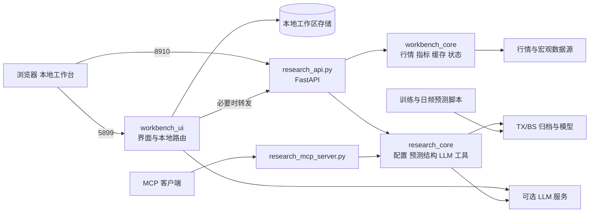

# 本地工作台

基于 DualAlpha-Lite 的本地量化研究工具，整合 TX/BS 双轨预测、因子分析、市场观察与可选 AI 解读。

**预测核心**：XGBoost、LightGBM、CatBoost、Transformer 和逻辑回归融合。**解释层**：DeepSeek、火山方舟或兼容接口，将结构化证据整理为文字。模型权重和个人数据不随仓库发布。

## 功能

| 模块 | 功能 |
|---|---|
| 市场 | 指数、板块、涨跌宽度、资金、分时与多市场观察 |
| 我的 | 自选搜索、技术条件、指标证据与可选 AI 分析 |
| 研究 | 双轨归档对照、因子预设、历史回测、模型注册与版本查询 |
| 资料 | 宏观、汇率、估值及外部研究数据 |

TX 与 BS 分别覆盖科技成长和主板，形成四套因子及模型路径。每套使用四类基模型，再由逻辑回归融合。`raw_prob` 是模型分数，泛化表现和概率校准需要独立验证。

## 架构



前端是本机运行的 Vinext/React 应用，Cloudflare 插件仅模拟本地存储；无需旧 Sites 项目或 Cloudflare 账号。完整组件、接口与数据流见 [架构说明](docs/ARCHITECTURE.md)。

## 快速部署（Windows）

需要 Git、Python 3.10+、Node.js 22.13+ 和 pnpm。下载/克隆后进入仓库根目录：

```powershell
git clone https://github.com/MottoZ123/dualalpha-lite.git
cd dualalpha-lite
powershell -NoProfile -ExecutionPolicy Bypass -File .\scripts\setup_local.ps1
```

在两个终端分别运行：

```powershell
# 终端一：研究服务
powershell -NoProfile -ExecutionPolicy Bypass -File .\scripts\start_backend.ps1
```

```powershell
# 终端二：本地界面
powershell -NoProfile -ExecutionPolicy Bypass -File .\scripts\start_workbench.ps1
```

打开 http://127.0.0.1:5899。后端为 http://127.0.0.1:8910，API 文档位于 `/docs`。

默认启动市场研究与已有归档查询；训练、主动模型执行、新回测 API 均关闭。未配置 LLM 时仍可使用确定性指标。首次运行没有权重/报告时，对应模型结果为空，需要自行训练或导入自己的研究资产。

详细配置、训练、MCP、更新、备份与排错见 [部署说明](docs/LOCAL_DEPLOYMENT.md)。

## 原始双轨模型

| 轨道 | 特征侧重 | 训练入口 | 模型目录 |
|---|---|---|---|
| TX 科技成长 | 趋势、形态、资金流 | `train_tx.py` | `models_tx/` |
| BS 科技成长 | 成本偏离、换手、量价 | `train_advanced.py` | `models/` |
| TX 主板 | 价格结构、偏离、反转 | `train_mainboard_tx.py` | `models_tx_v7/` |
| BS 主板 | VWAP、资金流、流动性 | `train_mainboard_bs.py` | `models_bs_v6/` |

四套因子分别为 13、13、10、10 个特征，详见 [因子清单](docs/FACTOR_CATALOG.md)。[研究方法](docs/RESEARCH_METHODS.md) 说明训练分段、融合方式和回测口径。

## 文件与验证

- [文件索引](docs/DIRECTORY_GUIDE.md)：每个模块/入口的简短功能说明。
- [验证记录](docs/VALIDATION.md)：本次执行结果和未覆盖范围。
- [来源与许可](docs/SOURCE_AND_LICENSE.md)：原项目及依赖来源。
- [共同开发者](CONTRIBUTORS.md)。

```powershell
.\.venv\Scripts\python.exe -m unittest discover -s tests -v
cd workbench_ui
pnpm run build
node --test tests/local-workbench.test.mjs
```

## 使用边界

本项目用于研究与复盘，不含自动下单。持仓保持 Mode A。正式交易所数据需要独立授权；无授权时显示降级来源。内置交易日历覆盖 2026 年。默认仅监听本机，不能直接作为公网部署。仓库保留原始训练入口和数据目录名，便于继续使用既有模型；权重、密钥、报告、缓存和运行数据库不上传。
